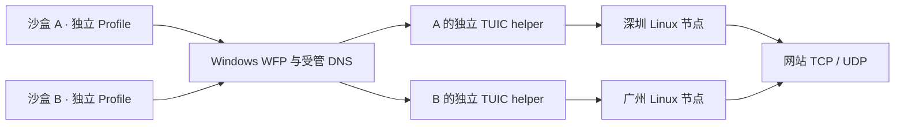

# 架构与必须保持的约束

## 运行位置

Windows 运行共享的 CEF 程序和每沙盒独立 BrowserHost 进程组；所有 Profile 数据在本机。
Linux 负责经过认证的 TCP/UDP 出口、DNS 和个人文件 API，不运行远程桌面或浏览器。

图中的 WFP 接管、DNS 接管与 BrowserHost 启动链仍未实现，不能用当前模型测试代替它们。

## 每沙盒独立联网

运行时绑定由 `(user_id, sandbox_id, node_id, generation, tunnel_id)` 组成。
TCP 数据流索引用完整绑定加 Stream ID；UDP 使用完整绑定加 Association ID，分片还需要包编号。
相同编号可以出现在不同连接中，不能用全局裸编号分发回包。

每沙盒一个 helper/独立连接上下文，目标节点在一次会话中不可变。
断线后原绑定失效，旧握手、旧流和迟到回包不能复活旧连接。
切换节点递增代次，终止旧浏览连接并重新建通道，不迁移活动 TCP 或 UDP 会话。
节点不可达时阻断，不允许走本机、另一个节点或全局系统代理。

当前 TUIC 配置只允许字面 IP 节点地址，TLS 名称单独设置，证书验证开启；本地 SOCKS 认证仅供受信 broker 使用。
离线设置中的 node_id 必须与本机绑定一致。这只验证人工元数据一致性；正式地址与证书绑定必须从受信节点注册/已认证的控制面获取，尚未实现。

## Windows 强制管控

WFP 默认阻断必须在 BrowserHost 启动前存在。沙盒需要独立受限运行身份、受控进程树与 Job、不可重用的进程生命周期标识。
TCP 需要 ALE 重定向及原目标恢复，UDP 需要捕获、吸收、代理、正确回注和 socket/endpoint 关联。
IPv4/IPv6、loopback、本地其他代理、系统 DNS 服务代查、WebRTC、扩展和子进程均属于验收范围。

仓库的 `wfp-baseline` 只安装按 BrowserHost 路径匹配的阻断规则。它不是上述完整实现。
CLI 的 GuardBackend 与 UI 的本地门禁始终拒绝联网启动，不读取配置布尔值来声明防护就绪。

## 文件与浏览器会话

Linux 文件路径为服务目录下的 `<认证用户 UUID>/<相对路径>`。用户身份来自 token，不能由 API 路径或请求体指定。
同用户同节点的多个沙盒共享个人区，不同用户分目录并检查授权；不同节点不自动同步。
服务用非 root 账号运行，目录为 0700；描述符相对访问、拒绝 symlink 和特殊文件，不赋予 API 用户服务账号的 SSH 权限。

浏览器下载的最终桥接路径为：原网页会话 → 本沙盒临时文件 → 原节点文件 API 原子提交。
上传路径为：文件选择器列出原节点个人区 → 下载选中的远端文件至本沙盒临时区 → 交给原网页 input。
保留原网页 Cookie、POST/blob 行为；文件服务不获得浏览器 Profile/Cookie。
文件任务从创建起记录 node_id，切换浏览节点不能改写其原节点。Linux 提交成功前不能显示“已存入个人区”。
上述浏览器桥尚未实现；当前文件 API 和任务归属模型可单独运行。

## 清理

关闭沙盒或切换节点保留 Profile、缓存和本机任务。删除沙盒才清本沙盒本地数据及任务记录。
删除本机沙盒不调用 Linux 删除接口，不能清掉同用户其他沙盒共享的文件。
文件 API 的 DELETE 是用户显式删除远端文件/空目录的独立操作。
