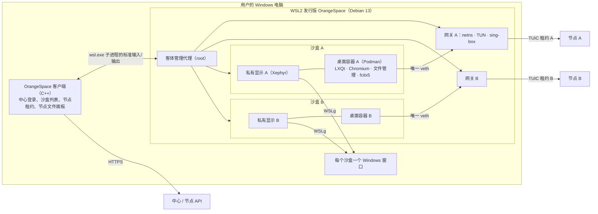

# 架构与必须保持的约束

选型理由、方案对比与实测依据见 [WSL2 Linux 桌面方案](proposal-wsl-linux-desktop.md)。原生 Windows CEF/WFP 方案已退役，记录在 [archive/architecture-windows-native.md](archive/architecture-windows-native.md)。

## 目标

用户登录 Windows 客户端后看到自己的沙盒列表，可以同时打开多个沙盒。每个沙盒是**一个窗口里的完整 Linux 桌面**（任务栏、文件管理器、Chromium，可装其他程序），拥有独立的文件、浏览器配置和登录状态。每个沙盒的**全部网络流量**（TCP、UDP、DNS，任何程序）只经该沙盒绑定的 Linux 节点出网，不同沙盒可绑定不同节点。中心与节点只提供身份、授权、网络出口、DNS 和个人文件 API，不运行桌面、不渲染画面。

## 运行位置

## Windows 客户端

- 负责中心登录、授权节点、沙盒的创建/绑定/打开/停止/删除、节点租约的创建与续租、节点个人文件面板。凭据用当前用户的 DPAPI 保存。不使用 LocalSystem 服务。
- 管理 WSL 发行版 `OrangeSpace`：检查 WSL 可用，首次运行用 `wsl --import` 导入，**从用户的交互会话中启动**（WSLg 只连接最先启动 WSL 的会话），常驻一个 `wsl.exe` 控制进程（否则发行版会被自动停止），退出时正常关闭。
- 控制通道是客户端启动的 `wsl.exe -d OrangeSpace -u root -- python3 /opt/orangespace/wsl/agent.py` 子进程的标准输入/输出（`linux-desktop/wsl/agent.py`、`apps/windows-client/include/orangespace/wsl_channel.hpp`）。管道只属于客户端进程，持有管道即认证；不开端口、不建命名管道。代理先输出同步标记，客户端跳过 wsl.exe 可能打印的提示后再按帧（类型、编号、长度，载荷不超过 64 KiB）收发 JSON 请求与回复。

## 发行版 OrangeSpace

- 本项目构建的 Debian 13 根文件系统，内含客体代理、Podman、桌面镜像、sing-box、网关、Xephyr、fcitx5。随附完整软件包清单与源码获取方式。
- `/etc/wsl.conf`：开启 systemd；**关闭 Windows 磁盘自动挂载与互操作**（`[automount] enabled=false`，`[interop] enabled=false`，`appendWindowsPath=false`）；默认用户非特权。
- 用户数据（各沙盒 HOME、浏览器数据、下载）与系统部分分开，升级系统时保留数据。

## 每个沙盒

| 组成 | 约束 |
|---|---|
| 绑定 | `(user_id, sandbox_id, node_id, generation, tunnel_id)` 显式绑定。一个沙盒同时只绑定一个节点、一个网关、一个 TUIC 凭据、一个显示；同节点的不同沙盒也不共用这些对象 |
| 桌面容器 | Podman（rootful，由代理调用）。非 root 用户、独立 HOME、只读根、无新权限、seccomp、Landlock、cgroup 资源限制；保留 Chromium 自身沙盒 |
| 显示 | 每沙盒一个 Xephyr，作为 WSLg 客户端出现为一个窗口，标题含沙盒名。容器只挂载本沙盒的显示 socket 与 Xauthority cookie，**不得访问 WSLg 公共显示 `:0`**；私有 `/tmp/.X11-unix` 在本沙盒的挂载命名空间里 |
| 输入法 | Windows 输入法传不进 Linux 窗口。每个沙盒会话内运行 fcitx5 拼音，默认开启，左 Shift 切换中英（Ctrl+空格 常被客户端操作系统截走） |
| 剪贴板 | 默认隔离：沙盒与 Windows、沙盒与沙盒都不互通，Xephyr 不桥接剪贴板 |
| 文件 | 文件管理器管理本沙盒 HOME。节点个人文件由客户端文件面板管理，可经代理在"节点文件 ↔ 本沙盒下载目录"之间传送 |

## 网络：全流量走节点

- 每个沙盒一个网关网络命名空间：TUN + 本沙盒 sing-box，TUIC 到绑定节点。桌面容器只有一条到该网关的 veth，没有其他接口。
- 网关内 nftables 只把桌面的 IPv4 TCP/UDP（含 DNS）送进 TUN，直接转发到上行的一律丢弃；发行版根命名空间只放行该网关的上行到该节点 IP 与 UDP 端口，返回流量须匹配有效许可。IPv6、跨沙盒、宿主与常见内网地址阻断。DNS 由节点解析。
- **出口许可随租约**：节点租约剩余寿命不超过 30 秒、需持续续租（[租约协议 v2](lease-protocol-v2.md)）。客户端每次续租成功，通知代理把该网关的内核限时许可（nftables 带超时的集合元素）续到新的截止时间，不超过租约剩余寿命。客户端崩溃、续租失败、注销或中心撤销时不再续期，许可由内核自动过期，不依赖任何进程正常收尾。
- 节点不可达、隧道退出、租约失效或规则读回不一致时，该沙盒断网；不允许走本机网络、另一个节点或系统代理。
- 状态分为"网络离线 / 网关就绪 / 节点在线"，只有经本沙盒出口成功访问 HTTPS 探测目标才显示"节点在线"。

## 绑定与代次

切换节点：停止该沙盒网关与桌面，代次加一，换新租约与新许可后再启动。HOME 保留，活动连接不迁移。旧代次的租约、凭据与许可不能复活。

## 文件

Linux 节点文件路径为服务目录下的 `<认证用户 UUID>/<相对路径>`。用户身份来自 token，不能由 API 路径或请求体指定。同用户同节点的多个沙盒共享个人区；不同节点不自动同步。服务以非 root 账号运行，目录 0700，描述符相对访问，拒绝 symlink 和特殊文件。文件任务创建时固定 node_id，切换节点不改写历史任务归属。

## 清理

关闭沙盒或切换节点保留 HOME。删除沙盒只清本沙盒的容器、HOME、网关与本机任务记录，不调用节点删除接口。文件 API 的 DELETE 是用户显式删除远端文件的独立操作。

## 信任边界与已知残余风险

- 当前 Windows 登录用户与本机管理员受信；用户本来就能以 root 进入发行版，本设计不防用户本人。要防的是沙盒内程序越出本沙盒（读他人文件、借他人出口、截他人画面）以及流量绕过节点。
- 所有沙盒共用 WSL 的 Linux 内核：容器逃逸到发行版 root 会影响所有沙盒，容器加固是硬要求。
- 出口约束覆盖沙盒应用流量；发行版自身的系统流量（如更新）不经节点，属于宿主侧。
- 显示走软件渲染，视频与高分屏性能需物理机验收；不足时再评估每沙盒嵌套 Wayland 合成器。
- WSL 可能被企业策略禁用或与其他虚拟化软件冲突，安装前检测并明确提示。
