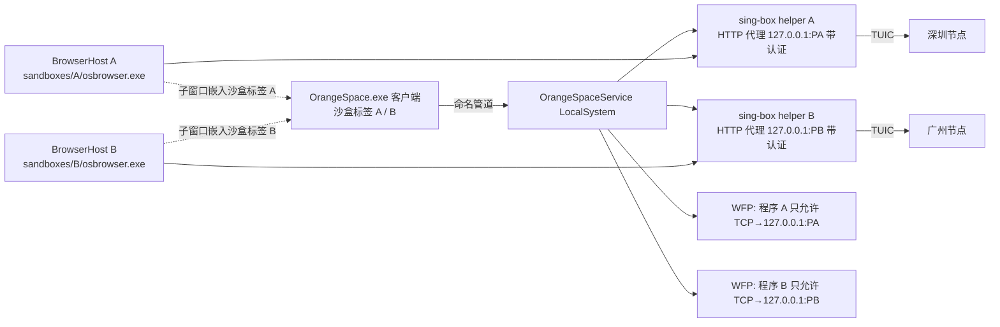

# 架构与必须保持的约束

## 目标

Windows 上同时运行多个沙盒。每个沙盒有独立浏览器（独立 Profile、Cookie、登录状态），网络只走该沙盒绑定的 Linux 节点；每个沙盒可以管理该节点上当前用户的个人文件。Linux 只提供网络出口、DNS 和文件 API，不运行浏览器或远程画面。

## 联网路线：显式代理 + 每沙盒 WFP 兜底

每个沙盒 S（绑定节点 N、代次 g）由服务按以下顺序启动，任一步失败即停止并回收已建立的部分：

1. 向节点 N 申请隧道租约（`docs/lease-protocol-v2.md`），启动该沙盒独立的 sing-box helper。入站为带用户名密码的 HTTP 代理，只监听 `127.0.0.1` 的随机端口 P；出站为 TUIC 到节点 N。Chromium 不支持 SOCKS5 认证，所以浏览器侧必须用 HTTP 代理。
2. 准备该沙盒自己的运行时目录 `sandboxes/<sandbox_id>/`：以硬链接镜像共享运行时（跨卷时复制），因此每个沙盒的 `osbrowser.exe` 有独立的程序路径，也就是独立的 WFP AppId。目录授予 ALL APPLICATION PACKAGES、ALL RESTRICTED APPLICATION PACKAGES 与 `lpacChromeInstallFiles` 读/执行，供 Chromium 自己的沙盒子进程加载运行时。
3. 按该程序路径（`FWPM_CONDITION_ALE_APP_ID`）安装 WFP 规则：只允许 TCP 到 `127.0.0.1:P`，其余 IPv4/IPv6 TCP/UDP 与入站全部阻断。安装后逐条读回核实，并确认没有多余规则指向同一身份。
4. 以会话用户的普通（非提权）令牌、在独立的 kill-on-close Job 中启动 BrowserHost。代理凭据经管道传入，不进入命令行、环境变量或文件。

为什么不把 BrowserHost 放进 AppContainer（2026-11 在 Windows 11 26H2 上实测）：CEF/Chromium 的浏览器主进程是沙盒 broker，需要为子进程创建受限令牌、Job 和备用桌面，在 AppContainer 内启动即断点退出；Chrome 本身也不这样运行。所以浏览器主进程按程序路径隔离网络，渲染器、GPU、网络服务等子进程仍由 Chromium 自己的沙盒（受限令牌/AppContainer/LPAC）保护。WFP 规则在包 SID 与 AppId 两种身份下都经 `orangespace-netcheck` 实测：只有本沙盒代理端口可达，其他沙盒端口、公网、局域网、`::1` 与 UDP（以实际收包计）全部被拦。

BrowserHost 约束：

- CEF 的 `root_cache_path` 为本沙盒 `profile` 目录；所有标签和弹窗使用同一请求上下文。
- `--proxy-server=http://127.0.0.1:P`，代理认证只在 `GetAuthCredentials(isProxy=true)` 且主机端口完全匹配时应答。必须带 `--disable-chrome-login-prompt`：否则 CEF 的 Chrome 运行时用自带登录框处理认证，根本不调用 `GetAuthCredentials`，还会让用户（或钓鱼页面）接触到代理凭据。
- 必须以非提权令牌启动：Chromium 拒绝提权令牌（退出码 38）。客户端和 BrowserHost 处于相同完整性级别；提权进程的窗口不能做 BrowserHost 的父窗口（UIPI）。
- 关闭 QUIC 和 DNS 预取；WebRTC 使用 `disable_non_proxied_udp`。

## 客户端界面与浏览器内嵌

用户登录客户端后看到自己的沙盒列表；每个打开的沙盒是客户端里的一个沙盒标签，标签内显示该沙盒的浏览器和文件管理。客户端负责启动、关闭沙盒，但浏览器始终运行在该沙盒自己的 BrowserHost 进程里。

- 内嵌方式是本机原生子窗口：BrowserHost 用 CEF `SetAsChild(客户端为该沙盒创建的容器窗口, 区域)` 创建浏览器，由系统直接合成显示。不做截图、离屏渲染或画面传输；输入法、剪贴板、拖放、DPI 均走系统原生路径。
- 每个沙盒在客户端里有自己的容器窗口。切换沙盒标签只显示/隐藏容器，不停止后台沙盒，网页会话保持。
- 浏览器外壳（地址栏、前进/后退/刷新、网页标签栏、文件按钮）由客户端绘制。服务打开浏览器（OSP3 op 10）后把 BrowserHost 的命令管道（stdin 写端）和事件管道（stdout 读端）复制给客户端，客户端直接收发逐行 JSON；含代理凭据的配置行由服务先写入，客户端拿不到；一个沙盒内的多个网页标签是同一 BrowserHost 进程、同一请求上下文中的多个 browser。嵌入模式不使用 Chrome 自带的标签栏和工具栏。
- 容器窗口句柄由客户端经服务传给 BrowserHost；客户端在使用前核验 BrowserHost 进程身份（程序路径为该沙盒的 `osbrowser.exe`、会话、创建时间一致），不按窗口标题或进程名匹配。
- 不修改交互会话 `WinSta0`/`Default` 的 DACL。实测只要加入一条具体包 SID 的 ACE，该登录会话内所有低完整性进程（包括 Chromium GPU 进程）加载 user32 都会失败（`ERROR_DLL_INIT_FAILED`），直到用户注销；系统默认已授予 ALL APPLICATION PACKAGES 与 ALL RESTRICTED APPLICATION PACKAGES。`orangespace-netcheck --user32-restricted` 用于检查会话是否处于该状态。
- 跨进程父子窗口会共享输入队列：客户端对每个沙盒做无响应检测，超时后由服务结束该沙盒的浏览器进程，其他沙盒不受影响。焦点、快捷键、窗口尺寸和 DPI 变化由客户端同步给子窗口。
- 不采用“所有沙盒共用一个浏览器进程”的嵌入方式：那样 WFP 无法按沙盒区分流量。

DNS：浏览器经 HTTP 代理发送 CONNECT 时携带域名，sing-box 将域名交给 TUIC，由节点上的 Unbound 解析，本机不解析目标域名。

节点不可达、helper 退出、租约失效或规则读回不一致时，该沙盒浏览器断网或被关闭；不允许走本机网络、另一个节点或系统代理。

## 绑定与代次

运行时绑定为 `(user_id, sandbox_id, node_id, generation, tunnel_id)`。一个沙盒同时只绑定一个节点、一个 helper、一个代理端口、一组 WFP 规则；相同节点的不同沙盒也不共用这些对象。

切换节点：停止该沙盒浏览器和 helper，代次加一，换新端口并更新规则后再启动。Profile 保留，活动连接不迁移。旧代次的租约、端口和凭据不能复活。

## 文件

Linux 文件路径为服务目录下的 `<认证用户 UUID>/<相对路径>`。用户身份来自 token，不能由 API 路径或请求体指定。同用户同节点的多个沙盒共享个人区；不同节点不自动同步。服务以非 root 账号运行，目录 0700，描述符相对访问，拒绝 symlink 和特殊文件。

浏览器文件桥（P3 实现）：

- 下载：网页会话 → 本沙盒 `tasks/tmp`（仅该 AppContainer 可写）→ 原节点文件 API 原子提交。节点确认提交前不显示“已存入个人区”。
- 上传：选择器列出原节点个人区 → 下载选中文件到本沙盒临时区 → 交给网页的文件 input。
- 文件任务创建时固定 node_id，切换节点不改写历史任务归属。文件服务拿不到浏览器 Profile/Cookie。

## 清理

关闭沙盒或切换节点保留 Profile、缓存和本机任务。删除沙盒只清本沙盒本地数据、任务记录、AppContainer 和 WFP 规则，不调用 Linux 删除接口。文件 API 的 DELETE 是用户显式删除远端文件的独立操作。

## 已知残余风险

- WFP 无法把系统 DNS Client 服务的代查归到浏览器名下。显式代理下浏览器不在本机解析目标域名，但需要抓包确认。
- 按程序路径区分沙盒意味着：能以该用户身份在 `sandboxes/<id>/` 写入或替换 `osbrowser.exe` 的进程可以冒用该沙盒的出口。正式安装时 `sandboxes/` 位于服务所有、用户只读的目录，由服务创建和校验（P5）。
- 网站 HTTP 基本认证当前一律拒绝（`GetAuthCredentials` 只应答本沙盒代理）；以后如需支持，由客户端界面单独询问，绝不复用代理凭据。
- 浏览器 UDP 全部阻断：QUIC 回落到 TCP，WebRTC 只能经 TURN-over-TCP 或不可用。
