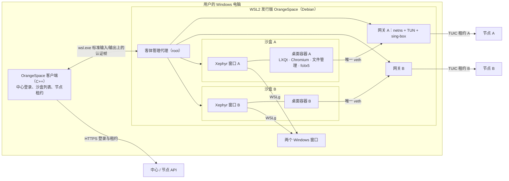

# 方案：以 WSL2 为底座的 Linux 桌面沙盒

状态：2026-11-20 批准（第 9 节已定案）。现行约束见 `AGENTS.md`、`docs/architecture.md`、`docs/roadmap.md`；本文保留选型理由与实测依据。

## 1. 为什么调整

目标是**沙盒的全部流量都走该沙盒绑定的节点**：浏览器的 TCP、UDP（QUIC、WebRTC）、DNS，以及沙盒里任何其他程序的流量。同时，**每个沙盒是一个窗口里的完整 Linux 桌面**（任务栏、文件管理器、浏览器、可装其他程序），而不只是一个浏览器窗口。

原生 Windows 方案（CEF + 每沙盒 WFP，已在测试机跑通）做不到这两点：

- Chromium 的代理只转发 TCP。要把某个进程的 UDP 按沙盒送进节点，Windows 上需要 WFP 重定向驱动，而项目约定不开发内核重定向驱动。所以 UDP 只能封锁，WebRTC 通话、QUIC 都不能经节点使用。
- 按程序路径（WFP AppId）区分沙盒：能写入或替换该 `osbrowser.exe` 的进程就能冒用该沙盒的出口。
- 沙盒里只有浏览器，没有桌面，也管不到其他程序。

Linux 的网络命名空间 + TUN 网关天然满足"一个沙盒的所有进程只有一个出口"。分支 `feat/linux-desktop-sandboxes` 已实现这套网关，本方案沿用它，把运行底座从"自带 QEMU/WHPX + Cygwin XWin"换成 Windows 自带的 WSL2/WSLg。

## 2. 已有的实测依据

在 Windows 11 26H2 测试虚拟机（KVM 嵌套虚拟化）上，2026-11-20：

| 项目 | 结果 |
|---|---|
| WSL 3.0.5（内核 6.18）+ Debian 13 | 可用；systemd、nftables、TUN、veth、网络命名空间、cgroup v2、seccomp、Landlock 可用 |
| 分支网关回归 `network/smoke.py` | 全部通过：两沙盒并发经各自 TUIC 节点出网（TCP/UDP/DNS）、远端节点掉线、本地隧道被杀、显式停止、内核许可到期封锁、持续授权与撤销、HTTPS 探测、兄弟沙盒长连接 SHA-256、直连对照零请求 |
| 每沙盒完整桌面 | 每个沙盒一个 Windows 窗口（WSLg 中的 Xephyr），内跑 LXQt + 文件管理器 + Chromium；沙盒 B 整个桌面在独立网络命名空间中，显示正常 |
| 中文输入 | Windows 输入法传不进 Linux 窗口；每沙盒运行 fcitx5 拼音，默认开启、左 Shift 切换中英，用户确认可用 |
| AppArmor | WSL 内核编译了但**未启用**（生效 LSM：capability、landlock、yama、safesetid、selinux、bpf、ima） |

未验证：物理机上的流畅度（滚动、视频、高分屏）、真实公网节点抓包、睡眠唤醒、长时间运行。

## 3. 方案对比

| | 原生 Windows（main 现状） | 分支原方案（QEMU/WHPX + XWin） | **本方案（WSL2/WSLg）** |
|---|---|---|---|
| 全流量走节点 | 否，UDP 只能封锁 | 是 | 是（同一网关代码） |
| 每沙盒完整桌面 | 否 | 是 | 是 |
| 自带的第三方运行时 | CEF | QEMU、Cygwin/X、Python | 无（WSL 由微软提供），只带 Linux 根文件系统 |
| 显示链路 | 原生子窗口，GPU | X11 经 virtio-serial，无 GPU | WSLg（RDP RAIL）+ 每沙盒 Xephyr，软件渲染 |
| 中文输入 | Windows 输入法 | 沙盒内 fcitx5 | 沙盒内 fcitx5（已验证） |
| 前置条件 | 无 | 固件虚拟化 + WHPX | 固件虚拟化 + 虚拟机平台 + WSL |
| 隔离的主要依据 | WFP AppId + Chromium 沙盒 | 容器 + 网关命名空间 + nftables | 同左 |

## 4. 总体架构

### 4.1 Windows 侧

- **客户端**沿用现有 C++ 客户端的中心登录、授权节点、沙盒列表与绑定。浏览器嵌入、WFP、`browser_open` 相关部分退役。
- **WSL 运行时管理**（客户端新增）：
  - 检查 WSL 是否可用；
  - 首次运行时用 `wsl --import` 导入我们的发行版 `OrangeSpace`；
  - **从用户的交互会话中**启动它（WSLg 只连接最先启动 WSL 的会话），并常驻一个 `wsl.exe` 进程（否则发行版会被自动停止）；
  - 退出时正常关闭。
- **控制通道**：客户端启动 `wsl.exe -d OrangeSpace -u root -- python3 /opt/orangespace/wsl/agent.py`，经它的标准输入/输出传送分支 `bridge/wire.py` 的帧格式。管道只属于客户端进程，持有管道即认证，不再需要分支里按虚拟机启动密钥做的双向认证；也不需要额外的命名管道或端口。
- **Windows 服务**：见第 9 节决策 3。WSL 发行版按 Windows 用户注册，LocalSystem 服务不便直接管理；本方案默认由客户端直接管理，服务不再参与浏览器/网络路径。

### 4.2 发行版 `OrangeSpace`

- 我们自己构建的 Debian 13 根文件系统（不依赖应用商店版 Debian），包含客体代理、桌面镜像、sing-box、网关、Xephyr、fcitx5。
- `/etc/wsl.conf` 固定：
  - `systemd=true`；
  - **关闭 Windows 磁盘自动挂载与互操作**（`[automount] enabled=false`、`[interop] enabled=false`、`appendWindowsPath=false`），否则发行版里的进程能读写用户的 C 盘、启动 Windows 程序；
  - 默认用户为非特权账号。
- 用户数据（各沙盒的 HOME、浏览器配置、下载）放在发行版的 ext4 上。升级时替换系统部分、保留数据，具体做法在 L5 确定（例如独立数据 VHDX）。

### 4.3 每个沙盒

| 组成 | 说明 |
|---|---|
| 身份 | 沙盒 UUID 对应一个容器、一个网关、一个 X 显示 |
| 桌面容器 | 沿用分支的桌面镜像与生命周期：非 root 用户、独立 HOME、资源限制、Chromium 自身沙盒保留。容器技术见决策 2 |
| 显示 | 每个沙盒一个 Xephyr，作为 WSLg 客户端出现为一个 Windows 窗口，标题"OrangeSpace 沙盒 X"。容器**只拿到自己那块显示的 socket 和 Xauthority cookie**，看不到 WSLg 的公共显示 `:0`（否则一个沙盒能截取其他沙盒或 Windows 的画面与按键） |
| 输入法 | 容器会话内 fcitx5 拼音，默认开启，左 Shift 切中英 |
| 剪贴板 | Xephyr 默认不与 Windows 互通，沙盒之间也不互通。是否放开、如何放开见决策 4 |
| 网络 | 容器只有一条 veth 连到本沙盒网关命名空间（分支 `network/gateway.py`）；网关内 TUN + sing-box TUIC 到绑定节点；发行版根命名空间的 nftables 只放行该网关到该节点 IP/UDP 端口；IPv6、跨沙盒、宿主与内网地址全部阻断 |
| 文件 | 文件管理器管理沙盒本地 HOME；节点个人文件区的接入方式见 L4 |

> 2026-11-21 变更：远程桌面断开会让 WSLg 合成器崩溃，带走所有 Xephyr 窗口。显示改为每沙盒一个常驻 Xvnc 虚拟显示，Windows 窗口改为可重连的 vncviewer 查看器（Debian 13 不收录 Xpra）。隔离要求不变，见 `docs/architecture.md`。

### 4.4 节点租约与全流量出口

现有节点租约 v2：隧道租约剩余寿命不超过 30 秒，需持续续租；凭据与续租由已认证的客户端完成。分支网关已经有"内核限时许可"：nftables 集合元素带超时，过期即断。两者对接方式：

1. 客户端向节点创建隧道租约，把 TUIC 端点与凭据交给客体代理，代理写入该沙盒的私有配置并 `network/up`。
2. 每次续租成功，客户端通知代理，把该沙盒网关的内核许可续到新的截止时间（不超过租约剩余寿命）。
3. 客户端崩溃、续租失败、注销或中心撤销时，不再续期，许可在租约剩余寿命内由内核自动过期。所以断网不依赖任何进程的正常收尾。

替换分支里静态节点 JSON 和本地账号的模式。

## 5. 安全边界

- **受信**：当前 Windows 登录用户和本机管理员。用户本来就能以 root 进入发行版，本方案不防用户本人。
- **要防的**：
  - 沙盒里的网页与程序越出本沙盒：读别的沙盒文件、借别的沙盒或本机出口上网、截取别的窗口；
  - 沙盒流量绕过节点。
- **共享内核**：所有沙盒共用 WSL 的 Linux 内核。容器逃逸到发行版 root，即可影响所有沙盒。所以容器加固（降权、seccomp、Landlock、无新权限、只读根）是硬要求。
- **与 Windows 的边界**：WSL 虚拟机 + 关闭自动挂载/互操作。即使拿到发行版 root，也不能直接读写 Windows 文件或启动 Windows 程序。WSL 与 Windows 之间的其他通道（剪贴板、WSLg）按需求收紧。
- **AppArmor 不可用**：WSL 默认内核未启用 AppArmor。分支的 AppArmor 配置要改用 Landlock + seccomp。也可以用 `.wslconfig` 的内核参数启用 AppArmor，但那会改用户全局的 WSL 设置，不建议。

## 6. 主要风险

| 风险 | 影响 | 应对 |
|---|---|---|
| 显示性能（Xephyr 软件渲染） | 视频、滚动、高分屏可能卡 | L1 在物理机实测；不够时改为每沙盒一个嵌套 Wayland 合成器（作为 WSLg 的 Wayland 客户端，可用 GPU） |
| WSL 不可用 | 企业策略禁用、无虚拟化、与其他虚拟化软件冲突 | 安装前检测并给出明确提示；最低系统版本写进安装要求 |
| WSL/WSLg 行为差异 | 会话绑定、空闲停止、版本升级回归 | 客户端负责启动顺序与常驻；固定最低 WSL 版本，升级前回归 |
| 分发许可 | 根文件系统含 GPL 等开源软件，分发即有源码提供等义务 | 需要你决定项目许可与合规做法（决策 5） |
| 节点不可用时的体验 | 网页打不开 | 状态栏按"网络离线/网关就绪/节点在线"显示；本地文件仍可用 |

## 7. 现有代码的去留

| 保留并复用 | 改造 | 退役（移入 archive 或删除） |
|---|---|---|
| `server/`（中心与节点）、租约协议 v2、`crates/orangespace-core` 的绑定与任务模型、`crates/orangespace-https`、客户端登录与中心 SDK、文件 API | 客户端：去掉浏览器嵌入，加 WSL 运行时管理；网关：接租约、改 AppArmor 为 Landlock/seccomp；桌面镜像：接 fcitx5 与私有显示 | `apps/browserhost`、`apps/windows-service/sandbox`（WFP）、原型服务与 CEF 打包、`tools/sandbox-devlaunch`（`orangespace-netcheck` 的思路移到 Linux 侧做出口验收） |

`p0-consolidation` 上未提交的 P0/P1 工作先完整提交保存，作为原生方案的最终状态，再在新分支上开展本方案。

## 8. 实施阶段

| 阶段 | 内容 | 验收 |
|---|---|---|
| L0 定案 | 审定本文与第 9 节决策；改写 `AGENTS.md`、架构与路线图；提交保存现有工作 | 文档合入 |
| L1 运行底座 | 构建 `OrangeSpace` 根文件系统；客户端导入、从交互会话启动、常驻与关闭；客体代理经 stdio 通信 | 测试机与一台物理机：客户端一键启动/停止发行版；物理机上记录桌面滚动、视频、高分屏的实际体验 |
| L2 沙盒桌面 | 每沙盒容器 + 私有 Xephyr 显示 + fcitx5 + 持久 HOME；打开、唤回、停止、重开 | 两个沙盒并排；容器内连不上 `:0`、看不到 `/mnt`、读不到对方 HOME；重开后文件与书签保留 |
| L3 全流量出口 | 分支网关接入；先用静态节点配置，再接中心租约与内核限时许可 | 用你提供的真实节点：Windows 网卡抓包只见到发往两个节点的 UDP；IP/DNS/WebRTC/QUIC 泄漏测试页显示各自节点出口；断开节点 A 后 A 离线、B 不受影响；客户端退出后许可在租约寿命内失效 |
| L4 产品功能 | 中心登录、授权节点、沙盒同步；节点个人文件区在桌面中的访问方式；下载与上传 | 按现有文件规则：同用户同节点共享、文件任务创建时固定 node_id |
| L5 安装与升级 | 安装器检测/开启 Windows 功能、安装 WSL、导入发行版；升级保留数据；卸载 | 全新机器安装、升级、卸载各一遍 |

## 9. 已定案的决策（2026-11-20）

1. **底座**：采用 WSL2/WSLg。不再采用分支原来的 QEMU/WHPX + Cygwin XWin，也不再推进原生 Windows CEF/WFP。
2. **容器技术**：Podman（rootful，由客体代理调用，不常驻守护进程）。沿用分支桌面镜像的 OCI 格式。
3. **Windows 服务**：浏览器与网络路径不再经过 LocalSystem 服务，由客户端直接管理 WSL 发行版。服务及其原型随原生方案一起退役；凭据保存继续用客户端现有的 DPAPI 存储。
4. **剪贴板**：默认隔离，沙盒与 Windows、沙盒与沙盒之间都不互通，Xephyr 不桥接剪贴板。以后如需要，只做客户端里由用户逐次触发的"粘贴到当前沙盒"单向操作，不做自动同步。
5. **许可与合规**：不替项目添加许可证（由用户另行决定）。分发的根文件系统随附完整软件包清单（名称、版本、Debian 源码包），按各软件许可提供对应源码获取方式。
6. **支持范围**：
   - Windows 11 22H2 及以上 x64，Windows 10 22H2 x64；
   - 要求开启硬件虚拟化，以及"虚拟机平台"和 WSL；
   - 在虚拟机里运行客户端只用于开发测试（需要嵌套虚拟化），不作为正式支持场景。
7. **节点个人文件区**：保留客户端现有的文件面板管理节点文件，新增"节点文件 ↔ 当前沙盒下载目录"的双向传送，经客体代理完成。桌面内暂不挂载远端文件系统。
