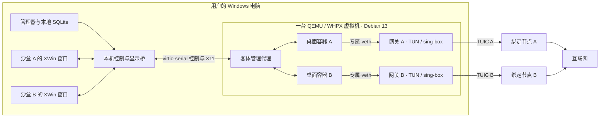

# OrangeSpace 本地 Linux 桌面架构

用户在 Windows 客户端登录本地账号后，可以创建沙盒、绑定节点，并把 A、B 两个桌面并排打开。每个沙盒独立运行 Chromium 和 PCManFM-Qt，单独保存文件和浏览器配置。所有桌面共享这台电脑上的一台 Debian 13 虚拟机和 Linux 内核。外部节点提供网络出口，桌面程序始终在本机运行。

## 运行位置与数据路径

Windows 管理器用 Python、Tk 和 SQLite 实现本地注册、登录和沙盒列表。第一次打开桌面或导入节点配置时，管理器启动 QEMU 和宿主桥。QMP 负责虚拟机启停，客体代理通过经过双向认证的 virtio-serial 通道接收沙盒操作。Docker Engine 运行在 Debian 中，由客体代理创建或停止指定容器。[Windows 管理器](windows/manager.py) · [QEMU 生命周期](windows/runtime.py) · [客体代理](bridge/guest.py)

## 一个桌面的生命周期

1. **创建与绑定。** 管理器记录账号、沙盒 UUID 和节点 UUID。用户可以在沙盒停止时导入节点配置。客体验证所有者和节点 ID，将凭据写入该沙盒的私有目录。
2. **打开。** 管理器为这个沙盒分配一个 XWin 顶层窗口和独立的 Xauthority 凭据。客体先创建仅有回环接口的容器，再配置网关。桌面以普通用户运行，保留 Chromium 自身的进程沙盒，并受 AppArmor、seccomp 和容器资源限制约束。节点暂不可用时，桌面仍可打开本地文件。
3. **使用。** LXQt、Chromium 和文件管理器共享本沙盒的 X11 会话。图形和键鼠与 Windows 窗口之间的传输只经过本机桥。客户端再次打开同一沙盒会唤回原窗口。默认设置关闭 X11 TCP 监听和宿主剪贴板共享。
4. **停止与重开。** 关闭某个桌面窗口后，管理器在轮询时停止对应沙盒。停止时先拆除网络出口，再给 Chromium 时间写回配置并回收容器。重开时挂载原 HOME。最后一个桌面停止后虚拟机待机，注销或退出管理器会请求客体正常关机。[桌面生命周期](guest/desktop) · [显示桥](bridge/host.py)

## 节点故障如何隔离

容器里的浏览器、文件管理器和其他进程共用一套路由。每个桌面只有一条专属 veth 连到自己的网关命名空间。网关的 nftables 规则将允许的 IPv4 TCP、UDP 和 DNS 流量送入 TUN，由本沙盒的 sing-box 加密发往绑定节点。桌面入口直接转发到网关上行的流量会被丢弃。在 Debian 根命名空间，上行还必须匹配该网关的接口、已授权节点 IP 和 UDP 端口。IPv6 默认封锁。[网络规则与实现](network/gateway.py)

| 事件 | 用户看到的结果 |
|---|---|
| 节点 A 掉线或 A 的隧道进程退出 | A 的外网请求失败，本地文件仍可用。绑定健康节点 B 的桌面可继续浏览和下载 |
| A 的持续本地授权被撤销 | 监督进程复核配置并撤销出口许可。如果监督进程异常退出，内核中的限时许可也会过期 |
| 节点恢复或更换 | 恢复后按原绑定重新建立连接。更换绑定或导入新凭据需要先停止相应桌面 |
| 共享虚拟机停止或宿主断网 | 使用这台虚拟机或链路的桌面会共同受影响。多个沙盒绑定同一个故障节点时，这些沙盒都失去该出口 |

状态分为「网络离线」「网关就绪」「节点在线」。只有沙盒经绑定出口成功访问配置的 HTTPS 探测目标，才显示「节点在线」。出口约束覆盖桌面应用流量，Debian 自身的 DHCP、系统维护与 Windows 的其他应用属于宿主或客体系统流量。[节点配置、授权和探测](network/README.md)

## 持久化与信任边界

| 位置 | 内容 |
|---|---|
| Windows 当前用户的 LocalAppData | SQLite 保存本地账号、带盐密码校验值、沙盒名称和节点绑定 |
| Debian 系统盘 | 客体代理、Docker、桌面 OCI 镜像、sing-box 和系统策略。构建时可选预置节点模板 |
| 独立数据盘 | 挂载到 `/var/lib/orangespace/desktop`。每个沙盒实例记录所有者，独立保存 HOME、Chromium 书签和 Cookie、Downloads，以及仅 root 可读写的已导入节点凭据 |
| 运行时 | 每次启动的桥接密钥、显示凭据、虚拟接口与网关进程均按运行会话创建和回收 |

备份用户工作区时要同时保留 Windows 的本地账号数据库和客体数据盘。当前 Windows 登录用户、本机管理员、客体管理员和共享内核属于信任边界。当前分支使用本地账号和 TUIC 节点配置，文件管理器管理沙盒本地文件。产品中心登录、中心动态租约和节点远端个人文件区尚待接入。[账号与沙盒目录](windows/workspaces.py) · [镜像与运行说明](README.md)

## 已验证的范围

- **双桌面与双出口。** 在 Debian ARM64 测试机中，两个真实 Chromium 访问同一测试地址，分别收到了两套隔离 TUIC 节点返回的 A、B 页面。切断 A 后，B 继续访问，长连接下载的 SHA-256 正确，模拟宿主直连的对照服务未收到额外请求。两个沙盒的本地文件独立，重开后书签和文件保留。[桌面集成测试](guest/smoke_x11.py) · [网络故障测试](network/smoke.py)
- **交付镜像。** x86-64 QEMU 软件模拟已验证双盘引导、数据盘挂载、控制通道认证、真实 Chromium 与文件管理器的图形传输，以及 ACPI 正常关机。[镜像启动测试](image/smoke-boot.py)
- **Windows 实机验收。** WHPX 下的 XWin 双窗口交互、睡眠唤醒后的第一包、两个真实公网节点在 Windows 物理网卡上的出口归属，仍待实机验证。[Windows 运行说明](windows/README.md)
